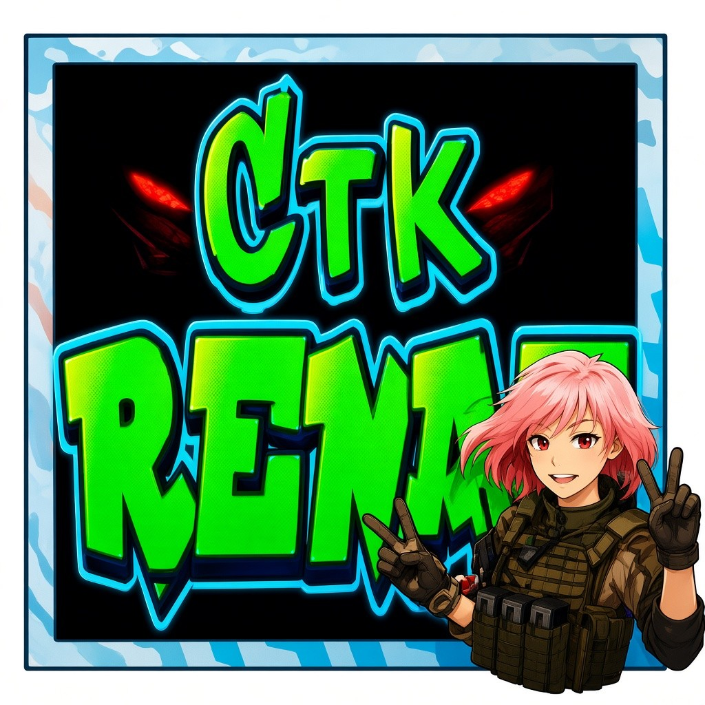

## Hi there 👋

I'm Nobody , I'm Just an keen , I’m a Sunday developer.
But I’m Determined

- 🔭 I’m currently working on ... everything and nothing
- 🌱 I’m currently learning ... all i can but it's to long 
- 👯 I’m looking to collaborate on ... everything and nothing 
- 🤔 I’m looking for help with ... everyone and no one
- 💬 Ask me about ... everything and nothing
- 📫 How to reach me: ... 🤔 
- 😄 Pronouns: ... !?
- ⚡ Fun fact: ... Ah ah ah ah ah ah 😄 
-->

<!--
**Renaf2/Renaf2** is a ✨ _special_ ✨ repository because its `README.md` (this file) appears on your GitHub profile.

Here are some ideas to get you started:

- 🔭 I’m currently working on ...
- 🌱 I’m currently learning ...
- 👯 I’m looking to collaborate on ...
- 🤔 I’m looking for help with ...
- 💬 Ask me about ...
- 📫 How to reach me: ...
- 😄 Pronouns: ...
- ⚡ Fun fact: ...
-->
